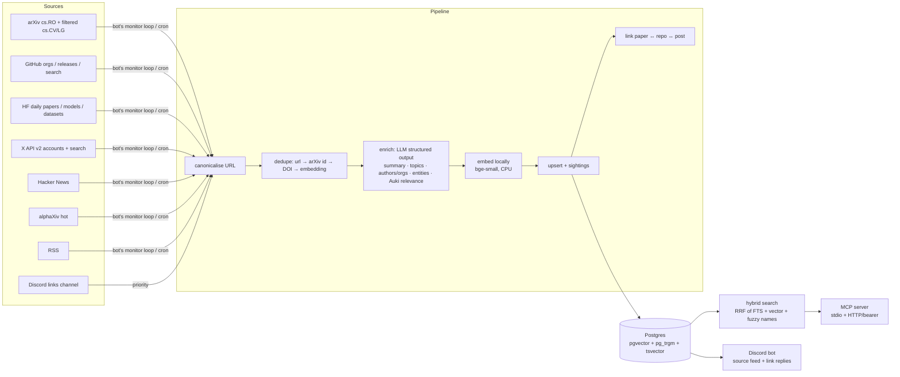

# Scout: a robotics research radar for Auki Labs

Scout watches the sources that matter for robotics (arXiv, GitHub, Hugging Face, X, Hacker News, alphaXiv,
RSS) and **the links the team drops in one Discord channel**. It keeps a searchable database of papers, repos,
posts, models and datasets (by **author, org and topic**) and reports in two places:

- **Discord (passive)**: a feed channel gets one short message per source run. Every item is a link, the
  Auki-relevant ones are marked 🔥 with a one-line reason, and off-topic noise is filtered out by the LLM.
  Links the team shares get a 4-bullet reply.
- **Any LLM (active)**: through MCP, ask Claude Desktop, Cursor or Claude Code anything about the
  database, e.g. *"what's new in visual relocalization this week, and who's behind it?"*. Answers cite links.



## Quick start (one command)

Runs entirely on your machine: Postgres in docker, embeddings on CPU, Claude for enrichment.

```bash
cp .env.example .env   # add ANTHROPIC_API_KEY (X_BEARER_TOKEN, GITHUB_TOKEN, DISCORD_* optional)
make setup             # local Postgres (docker), deps, schema, 7-day backfill
make bot               # monitor every source + post the Discord feed
```

**For a live demo:** `make demo` starts the bot on a fresh, separate demo database (your main one is untouched),
so the feed channel fills up source by source in front of you.

No keys yet? `LLM_PROVIDER=fake EMBEDDING_PROVIDER=fake make setup` runs the whole system offline with
deterministic heuristics, so tests, evals and demos work with zero credentials.

Then:

```bash
uv run scout search "visual relocalization" --since 7d
uv run scout ask "who is working on multi-robot shared maps?"
uv run scout add https://arxiv.org/abs/2611.05084        # ingest any URL now
make bot                                                # Discord bot
make mcp                                                # MCP over stdio
```

**Hosting later?** Any Postgres with pgvector works. Point `DATABASE_URL` at Supabase/Neon/RDS and run
`uv run scout migrate`. `.github/workflows/ingest.yml` is the hosted replacement for `scout scheduler`, and the
Dockerfile runs the bot and the MCP HTTP server together.

## Use it from an LLM client (MCP)

**Claude Desktop** (`claude_desktop_config.json`), local stdio:
```json
{
  "mcpServers": {
    "scout": {
      "command": "uv",
      "args": ["--directory", "/absolute/path/to/scout", "run", "scout", "mcp"]
    }
  }
}
```

**Cursor** (`.cursor/mcp.json`), hosted HTTP:
```json
{
  "mcpServers": {
    "scout": {
      "url": "https://<your-host>/mcp",
      "headers": { "Authorization": "Bearer <MCP_BEARER_TOKEN>" }
    }
  }
}
```

**Claude Code**:
```bash
claude mcp add --transport http scout https://<your-host>/mcp --header "Authorization: Bearer $MCP_BEARER_TOKEN"
```

| Tool | What it does |
|---|---|
| `search(query?, author?, org?, topic?, type?, source?, since?, min_relevance?, limit?)` | Hybrid search. Fuzzy, typo-tolerant author/org names (`"levine"`, `"eth zürich"`), relative dates (`"7d"`). |
| `get_item(id)` | Full record: summary, entities, metrics, related items |
| `find_related(id)` | Explicit links (repo *implements* paper, post *discusses* paper) + nearest neighbours |
| `author_profile(name)` | Items, topics, frequent co-authors, orgs |
| `trending(topic?, days?)` | Cross-source sightings + upvotes/stars/points/likes + Auki relevance |
| `digest(days?)` | Counts by topic, most Auki-relevant, trending |
| `add_link(url, note?)` | Ingest a URL now |

Every result carries `url`, so answers can cite sources.

## Discord

The bot does two things, and nothing else:

**1. The monitoring feed** (`DISCORD_FEED_CHANNEL_ID`). Every source runs on a schedule (X 3×/day to save
credits, everything else every 4h). Each run posts one message:

```
📡 arXiv · 40 new · 3 🔥 · 12 off-topic hidden
• 📄 CrossWeave: Cross-Modal Scene and Instance Retrieval from Sparse 2D-3D Alignment · 🔥 0.75
  ↳ Retrieving a 3D map region from a 2D query image is visual localization against a spatial map…
• 📄 Probing Spatial State Representations in Visual Foundation Models
• …+32 more (ask your LLM: search(source="arxiv", since="1d"))
```

Every title is a link (no preview cards). A failing source posts `⚠️ GitHub failed: …`, and health problems
(a source failing 3× in a row, an ingestion stall) are posted once.

**2. Team links** (`DISCORD_LINKS_CHANNEL_ID`). Post any link (paper, repo, X post, article) and get:

```
📄 LoD-Loc v4: Towards Generalized Aerial Visual Localization… · relevance 0.85
• What: An aerial visual localization method that registers a query image against a Panoptic LoD 3D map.
• Why Auki: Visual positioning against a shared 3D map is the relocalization problem the posemesh solves.
• Topics: slam-spatial-mapping, perception · Who: Shuaibang Peng, Chengming Zhang, Juelin Zhu et al.
• Related: Beyond Local Refinement: Wide-Area Precise…, PGGT-Loc: Primitive-Grounded Geometry…
```

Papers or repos the link points to are ingested and linked too. Anything else, such as questions or
digests, is done by talking to the database through an LLM (below).

## Example questions with real answers

→ **[docs/examples.md](docs/examples.md)**, generated by `scripts/examples.py` against the live database
(regenerate any time, so it's never stale).

## Evals

A hand-labelled set: **56 recent real arXiv papers** (topics + Auki-relevance band) and **21 search queries
+ 5 author queries** with relevant sets (`evals/*.jsonl`). `make eval` loads them into a throwaway DB through
the real pipeline and scores them.

| Metric | Keyword heuristic (no LLM) | **Claude Haiku 5.5** |
|---|---|---|
| Topic: primary topic correct | 46% | **91%** |
| Topic: any expected topic predicted | 70% | **96%** |
| Topic: micro-F1 over topic sets | 50% | **77%** (P 68%, R 89%) |
| Auki relevance: band accuracy (high/mid/low) | 38% | **75%** |
| Search: precision@5 (capped at #relevant) | 0.85 | **0.87** |
| Search: MRR / hit@1 | 1.00 / 1.00 | 0.98 / 0.95 |
| Author filter: precision / recall | 87% / 100% | 87% / 100% |
| Enrichment cost for 56 items | $0 | **$0.038** (~$0.0007/item) |

Both columns use the same local embedder (bge-small), so search differs only through the LLM's summaries.

**What the errors look like.** Every relevance miss is off by one band, and none confuse *high* with *low*.
The model is generous: 8 of the 15 papers I labelled *low* (peripheral robotics, e.g. a robot-tutoring HRI study)
got 0.40–0.50, just over the *mid* cut-off. Topic precision (68%) is lower than recall (89%) because the model
often adds a reasonable second or third topic that the labels don't have. I deliberately did **not** tune the
prompt against these 56 items, since that would be fitting to the test set. The fix is more labelled data and
a held-out split.

Full breakdown, confusion matrix and per-query scores: [`evals/results.md`](evals/results.md).
Search is measured with the real local embedder (no LLM involved). The tagging and relevance column needs
`ANTHROPIC_API_KEY`. CI runs a fully offline variant (hash embeddings, P@5 0.72) as a regression guard.

## Cost estimate (monthly)

Assumes roughly 250 new items/day (~7.5k/month) after dedupe.

| | Assumption | $/month |
|---|---|---|
| Enrichment (Claude Haiku 5.5) | measured $0.0007/item on the eval run | ~$5 |
| Embeddings | local bge-small on CPU (~25 ms/item) | $0 |
| Questions via MCP | the client's LLM does the reasoning; Scout only runs search | $0 |
| X API v2 (pay-per-use) | 5 seeded accounts + 2 queries, 3 runs/day, ≤20 new posts each, incremental via `since_id` | ≤ 12.6k post reads/month at the cap (usually far fewer) × X's current per-read price |
| Postgres | local docker (hosted later: Supabase/Neon free tiers cover months) | $0 |
| Bot + MCP host | local for the demo (hosted: a ~$5 container) | $0 |
| Cron | GitHub Actions, public repo | $0 |
| **Total** | | **~$5/mo of Claude + your X credits** |

Real per-item cost is recorded in `items.cost_usd` and per run in `ingest_runs.cost_usd`. The bot shows the
cost of each ingestion in its reply.

## How to add a source (~30 lines)

`src/scout/connectors/rss.py` is the template:

```python
@register
class MySource(Connector):
    name = "mysource"
    kinds = ("mysource_feed",)          # rows in the `sources` table this connector consumes
    needs = ("mysource_api_key",)       # optional: skipped (not failed) when unset

    async def fetch(self, http, kind, value, since):
        r = await http.get("https://api.example.com/items", params={"q": value})
        r.raise_for_status()
        return [Item(url=x["url"], type=guess_type(x["url"]), title=x["title"], source=self.name,
                     summary=x.get("abstract"), published_at=parse(x["date"]))
                for x in r.json()["items"]]
```

Then: import it in `connectors/__init__.py`, add the kind to the `sources.kind` check constraint (a new
migration), insert a `sources` row, add it to the matrix in `.github/workflows/ingest.yml`, and record one real
response under `tests/fixtures/` for a test. Canonicalisation, dedupe, enrichment, linking, retries, error
isolation and logging come for free.

## Design notes

The full reasoning is in [DECISIONS.md](DECISIONS.md). The highlights:

- **One SQL function does hybrid search** (FTS + vector + trigram, reciprocal rank fusion), and every hit says
  why it matched.
- **Dedupe is a ladder**: URL → arXiv ID → DOI → embedding similarity. Similarity applies to posts and
  articles only, because two different papers from one lab can look 0.93-similar.
- **Nothing is overwritten.** Each source's sighting is kept, and that cross-source buzz is the trending signal.
- **Links resolve in either order**: a repo ingested before its paper still gets linked.
- **What matters to Auki is a prompt file** ([`prompts/auki_context.md`](prompts/auki_context.md)), so the
  team can edit it without a deploy.
- **Idempotent and isolated.** Re-running is safe, one bad item or feed never stops a run, and connectors
  without credentials are skipped rather than failed.

## Known limits

- **X monitoring needs X API credits.** The connector is tested against a synthetic fixture in the documented v2
  response format until a recorded response replaces it. X links shared in Discord work without any key.
- **alphaXiv** uses an unofficial API and may break. It fails soft.
- **Author disambiguation is name-based** (normalised and fuzzy). Two "Wei Zhang"s collapse into one; ORCID or
  Semantic Scholar IDs would fix this.
- **PDF full text isn't extracted.** Papers are enriched from title and abstract, which is enough for tagging but
  not for deep Q&A.
- **Eval labels** were drafted by the AI pair-programmer and are pending a human review pass (`evals/items.jsonl`).
  56 items is a small set, so read the numbers as directional.
- **Exact vector scan** in filtered search is fine up to ~100k items. Beyond that, see DECISIONS D3.

## Roadmap: towards a shared team memory

1. **Exocortex**: ingest the team's own artifacts (Discord threads, meeting notes, internal docs) next to the
   external ones, with the same search and the same MCP. "What did we conclude about Gaussian-splat maps last
   month, and what's new since?"
2. **People and lab graph**: resolve authors to ORCID/Semantic Scholar/GitHub; follow people, not just feeds;
   alert when someone in Auki's orbit publishes.
3. **Watch questions**: standing queries ("anything beating our relocalization latency?") that fire alerts with
   an LLM judge instead of a threshold.
4. **Full-text RAG over PDFs** with section-level chunks, for questions like "which method did they compare against?".
5. **Feedback loop**: 👍/👎 on feed items to tune ranking and propose edits to `auki_context.md` (removed
   from v1 to keep the bot focused).
6. **Weekly digest + draft posts** in Auki's voice for human approval (also cut from v1 for focus).

## Repo map

```
migrations/        SQL schema, hybrid search function, seed taxonomy + sources
prompts/           enrichment prompt, Auki relevance rubric, Auki voice for drafts
src/scout/
  connectors/      arxiv, github, huggingface, x, hackernews, alphaxiv, rss, resolve (any URL → Item)
  pipeline/        run (orchestration), dedupe, enrich, store, link
  providers/       llm (anthropic | openai | fake), embeddings (openai | fake)
  search.py        hybrid search, related, author profiles, trending, digest, /ask
  mcp_server.py    7 MCP tools, stdio + HTTP with bearer auth
  bot/             Discord bot: monitor loop + feed + link replies
  health.py        health checks
evals/             labelled data + harness + results
tests/             connector tests (recorded fixtures), pipeline, search
```
