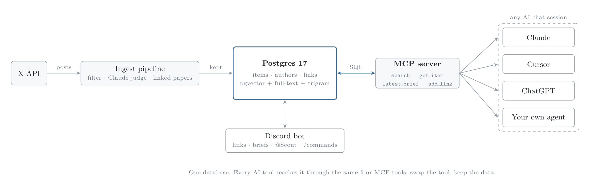

# Scout: a robotics news radar (built for Auki Labs)

- **X is the source.** Every 2 hours Scout scans ~80 trusted robotics accounts plus open searches for posts that link to papers, code or big news.
- **Only the signal is kept.** Free rules drop spam and low-engagement posts; Claude drops promo, off-topic and noise. In testing, nothing kept was junk.
- **Every post is followed to its source.** The arXiv paper, GitHub repo or Hugging Face model it links to is stored alongside it.
- **One Postgres database** holds everything, searchable by meaning, keywords, author and topic.
- **Used from Discord:** a daily brief (or `/scan`), paste links to store them, `/topic`, `/author`, `/recent`, and `@Scout` questions in plain English.
- **Used from any AI tool through MCP:** Claude, Cursor or your own agent can search the same database. No vendor lock-in.

## Architecture

