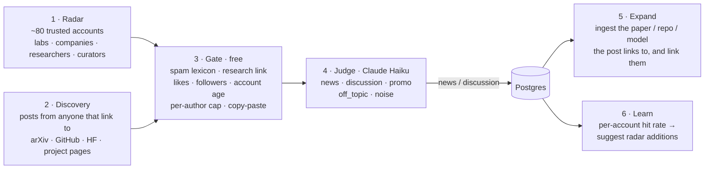

# Scout: a robotics news radar (built for Auki Labs)

**X is where robotics news breaks.** Scout watches X for high-signal robotics posts, follows each one to the
paper, code and model it points at, and stores all of it in one searchable database. It also reads the links the
team drops in Discord. You use it from Discord or from any LLM client:

```
 X  (radar accounts + link-anchored discovery)  ─┐
 Discord #links (anything the team shares)      ─┴─►  filter → Claude → database  ─►  Discord: brief · @Scout · /author /topic /recent
                                                         │                         ─►  MCP: Claude Desktop, Cursor, Claude Code
                       arXiv / GitHub / Hugging Face ◄───┘  (fetched because a post linked to them)
```

That's the whole product: **monitor (X + Discord) → store → search, by meaning or by author/topic.**

**Scope: robotics news in general**, not just what's relevant to Auki: humanoids, industrial and warehouse
robots, drones, autonomous driving, surgical robots and research. Every item gets two scores from the same
Claude call:
- **`importance`** (0–1): how significant it is for robotics as a whole. This decides what's kept in the brief,
  how stories are ranked, and how `/recent` and `/topic` are ordered.
- **`auki_relevance`** (0–1): how much it matters to Auki specifically. It's a secondary marker (🔥) and a
  tie-breaker, never a filter.

## How Scout finds the signal on X

X is noisy: spam, engagement bait, crypto, hot takes. Scout gets to the signal in six steps, and the cheap steps
come first:



1. **Radar (who):** curated accounts, packed into `from:a OR from:b …` searches under X's 512-character query
   limit. 80 accounts take 4 requests, not 80. They cover humanoids, research labs, autonomous driving
   (Waymo), drones (Zipline, Skydio), industrial (ABB, ANYbotics) and surgical (Intuitive). They're trusted,
   so they skip the gate.
2. **Discovery (what):** four searches for posts *from anyone* that link to research. They cover robot
   learning, code and models; drones, autonomous driving and surgical robots; and spatial AI. A fifth search
   finds **general news** (launches, funding, acquisitions, deployments). That news links to press and company
   sites rather than papers, so it's held to a higher bar instead: ≥50 likes and ≥1,000 followers. A research link is the strongest
   single anti-spam signal. Discovery reads a window that ends **6 hours ago**, so likes have time to build up
   before the gate looks at them.
3. **Gate (free, before any LLM):**
   - drop spam: crypto, airdrops, `$TICKER`, "link in bio";
   - require a research link and at least 10 likes;
   - below 50 likes, also require ≥200 followers and an account ≥90 days old;
   - at most 3 posts per author per scan;
   - drop copy-paste duplicates.

   Every threshold is in `config.py`.
4. **Judge:** the enrichment call that summarises and tags each post also labels it `news`, `discussion`,
   `promo`, `off_topic` or `noise`. Only news and discussion are stored. This catches what rules can't: a robotics
   lab posting about an LLM paper, or a CEO promoting their other company.
5. **Expand:** each kept post pulls in what it links to (arXiv paper, GitHub repo, HF model or dataset, project
   page) and links them, so the paper's authors and abstract become searchable. arXiv, GitHub and HF aren't
   scanned on a schedule any more. They're reached through posts.
6. **Learn:** Scout tracks how often each account's posts survive the judge. A non-radar account that keeps
   getting through is suggested in Discord (`⭐ @someone: 3 of 4 posts kept. /follow someone`). A person
   decides.

**A real scan** (first run, 2 days of backlog):

```
📡 Scanned X: 127 posts → 74 passed the filter → 39 kept (+7 papers/repos they link to)      $0.043
```

The 39 kept included Boston Dynamics' Stretch Gen 2, Xiaomi's CyberOne 02 on a factory line, Tutor
Intelligence's $75M Series B, Agility going public, LeRobot adding Galaxea's G0.5 VLA, and ETH's WayTrace.
Some of what the judge dropped: an LLM-reasoning paper from a curator account, "so cool 🐥", a CEO's post
about his other startup, a job opening, and university press posts about non-robotics research.

**Measured** on 62 real posts from that scan, labelled by content alone (would the team want this in their
feed?):

| | posts kept | precision | recall |
|---|---|---|---|
| gate only | 16 | 0.62 | 0.32 |
| **gate + Claude judge** | **10** | **1.00** | **0.32** |
| · radar accounts | 6 | 1.00 | 1.00 |
| · discovery | 4 | 1.00 | 0.16 |

The funnel is tuned for precision: everything it kept was worth reading. Discovery misses are mostly
arXiv-mirror bots and paper summarisers with 0–5 likes. The paper exists, but nobody on X is talking about it
yet, and filtering for what people are talking about is the point of "X is the newsroom". The snapshot was
recorded minutes to hours after posting, while live discovery waits 6h for likes, so this recall is a lower
bound. Details: [`evals/x_results.md`](evals/x_results.md). Rerun with `uv run python evals/x_signal.py`
(≈$0.01).

## Search: by meaning, or simply by author and topic

There is **one search function**: a hybrid of full-text, vector and fuzzy-name matching in a single SQL
function. Its structured fields are `author`, `org`, `topic`, `type`, `source` and `since`.

- **In plain language:** Claude turns the question into those fields, then the database answers exactly.
  *"What did ETH's legged robotics people post about navigation, and is there code?"* becomes
  `search(org="ETH Zurich", query="navigation")` (topped up with a plain search if the filters are too strict),
  and Claude writes the answer from the results with numbered sources.
- **Simply:** a slash command fills the same fields itself, with no LLM. `/author hutter` and `/topic slam`
  are free, instant and exact.

So "search by author/topic" isn't a separate system or a dashboard. It's the same search, filled in by Claude
or by you.

Meaning-based search: "robots sharing a map of a building" finds collaborative-SLAM papers that share no words
with the query. Entities Claude extracts (e.g. "GR00T", "Unitree G1") are indexed. Author and org names are
typo-tolerant ("Huter" finds Hutter).

## Discord

| | What happens |
|---|---|
| **#feed** | Every 2h a status line: `📡 Scanned X: 127 posts → 74 passed the filter → 39 kept (+7 papers/repos)`. Every 6h, **the brief**: the top 7–10 stories since the last one, written by Claude Opus. Each story is led by an X post and linked to its paper, code and model. Radar suggestions and health problems also appear here. |
| **#links** | Paste any link (an X post, paper, repo or article) and get a 4-bullet reply: what it is, how important it is, the Auki angle, topics and authors, and related items already stored. X posts are followed through to their paper and repo. |
| **@Scout** *question* | Plain-language answer from the database, with numbered source links. Also available as `/ask`. |
| `/author name` | Everything stored from one person: topics, orgs, co-authors, recent items. Autocompletes from the database. |
| `/topic topic [days]` | The latest items on a topic. Each post shows what it links to (`paper: …`, `code: …`). |
| `/recent [days]` | **What's stored:** counts by type, then the top posts and what they link to. |
| `/follow handle` · `/unfollow handle` | Edit the X radar. |

A brief, trimmed to 4 of its 10 stories (real output from the scan above):

```
📰 Robotics brief · Thu 05 Nov, 04:28 UTC · 46 new items → 10 stories

1. Xiaomi CyberOne 02 humanoids complete 8-hour shift in EV factory
Xiaomi claims first production-line-level humanoid operation alongside AMRs, and is also trialing its Robotics-1 model in housekeeping.
𝕏 @CyberRobooo · 𝕏 @CyberRobooo

3. RoboColosseum launches distributed real-world robot benchmarking network
Backed by Hugging Face and Unitree, it reports over 10,000 physical trials across four embodiments including SO-101 arms.
𝕏 @UnitreeRobotics · 𝕏 @CyberRobooo · 𝕏 @IlirAliu_ · 𝕏 @LeRobotHF

4. Interactive 3D World Simulator predicts manipulation scenes at 50+ FPS
Action-conditioned world model renders 3D Gaussian scenes from any camera, pointing toward spatially grounded robot simulation.
𝕏 @YunzhuLiYZ · jwang771.github.io · 𝕏 @IlirAliu_ · 𝕏 @chris_j_paxton

5. ETH's WayTrace takes legged robot from web-map directions to destination
Combines off-the-shelf VLM, onboard trace model and RL policy for map-guided long-range navigation, relevant to shared spatial maps.
𝕏 @leggedrobotics · 𝕏 @mateoguaman
```

Every label is a link. The editor model can only cite items in its candidate list, and URLs come from the
database, so it can't invent a link.

## Quick start

Runs entirely on your machine: Postgres in docker, embeddings on CPU, Claude for the judging, tagging, brief and answers.

```bash
cp .env.example .env   # ANTHROPIC_API_KEY, X_API_KEY + X_API_SECRET, DISCORD_TOKEN + channel ids
make setup             # local Postgres (docker), deps, schema, a first X scan
make bot               # the whole product: scans X, posts the brief, answers @Scout and slash commands
```

`make demo` runs the bot on a fresh, separate database, so you can watch the first scan and brief arrive.
Without keys, `LLM_PROVIDER=fake EMBEDDING_PROVIDER=fake` runs everything offline with heuristics, which is how
the tests run. From a terminal:

```bash
uv run scout ingest                                     # one X scan: seen / gated / judged out / kept / linked
uv run scout ask "who is working on multi-robot shared maps?"
uv run scout search --author hutter --since 30d
uv run scout add https://x.com/physical_int/status/…     # ingest any URL now (follows it to the paper/repo)
uv run scout brief --hours 24 --dry-run
```

## From any LLM client (MCP)

Four tools: `search` (free text and/or `author`, `org`, `topic`, `type`, `source`, `since`), `get_item` (full
record plus what it links to), `latest_brief`, and `add_link`. Every result carries a `url`, so answers cite
sources.

```json
{ "mcpServers": { "scout": { "command": "uv", "args": ["--directory", "/abs/path/to/scout", "run", "scout", "mcp"] } } }
```

That's Claude Desktop (`claude_desktop_config.json`). For a hosted server, `scout mcp --http` serves streamable
HTTP at `/mcp` behind `Authorization: Bearer $MCP_BEARER_TOKEN`:
`claude mcp add --transport http scout https://<host>/mcp --header "Authorization: Bearer …"`.

## Evals

Two eval sets:
- **X signal** (above): 62 real posts, gate + judge, precision 1.00.
- **Tagging and search:** 56 recent real arXiv papers, 21 search queries and 5 author queries
  (`evals/*.jsonl`). `make eval` runs them through the real pipeline in a throwaway database.

| Metric | Keyword heuristic (no LLM) | **Claude Haiku 5.5** |
|---|---|---|
| Topic: primary topic correct | 46% | **88%** |
| Topic: any expected topic predicted | 70% | **98%** |
| Topic: micro-F1 over topic sets | 50% | **78%** (P 69%, R 90%) |
| Auki relevance: band accuracy (high/mid/low) | 38% | **77%** |
| Search: precision@5 (capped at #relevant) | 0.85 | **0.87** |
| Search: MRR / hit@1 | 1.00 / 1.00 | 1.00 / 1.00 |
| Author filter: precision / recall | 87% / 100% | 87% / 100% |

LLM outputs vary between runs (two runs a day apart: 91%/88% primary topic, 75%/77% band), so read every
number as ±3 points. Every relevance miss is off by one band. I didn't tune prompts against the test items.
Full breakdown: [`evals/results.md`](evals/results.md).

## Cost (monthly, measured rates)

| | Basis | $/month |
|---|---|---|
| Judge + tagging (Claude Haiku 5.5) | ≈$0.0005 per judged post or linked paper (measured: $0.043 for 74 + 7); ~200/day | ~$3 |
| Brief (Claude Opus 5.5) | ≈$0.05–0.09 per brief (measured; more candidates now that scope is general), 4/day | ~$8 |
| @Scout questions (Claude Haiku 5.5) | ≈$0.002 per question | cents |
| Embeddings, Postgres, slash commands | local / no LLM | $0 |
| X API (pay-per-use) | 9 requests per scan (4 radar + 5 discovery), ≤100 posts each; each post read once (time cursors); 12 scans/day | your X credits (check X's current per-read price) |
| **Total** | | **≈$12/month of Claude + X credits** |

Per-item cost is in `items.cost_usd`, per scan in `ingest_runs.cost_usd`.

## Design notes

The full reasoning is in [DECISIONS.md](DECISIONS.md) (D23–D25 cover this X-first version). The highlights:

- **X-first, everything else is a resolver.** arXiv, GitHub and HF give the details, but X decides what's news.
- **Cheap before expensive:** query design, then free rules, then a Haiku label, then an Opus editor once per brief.
- **Precision over recall,** measured, with the trade-off stated rather than hidden.
- **One search, two ways in:** filled in by Claude for questions, by a slash command for lookups. No dashboard.
- **Dedupe is a ladder:** URL → arXiv ID → DOI → embedding similarity (posts and articles only).
- **What matters to Auki is a prompt file** ([`prompts/auki_context.md`](prompts/auki_context.md)), editable
  without a deploy.
- **Restart-safe and idempotent:** scan cadence, cursors and brief windows all live in the database.

## Known limits

- **Discovery recall is low by design** (above). The radar carries most of the signal, which is why `/follow` and
  the learn step exist.
- **Radar seed list:** ~80 accounts I chose. Auki should prune and extend it with `/follow` and `/unfollow`.
- **X recent search covers 7 days,** so a backfill can't reach further back.
- **Author disambiguation is name-based:** two "Wei Zhang"s collapse into one.
- **No PDF full text:** papers are tagged and searched from title and abstract.
- **Eval labels** were drafted by the AI pair-programmer and are pending human review.

## Roadmap

1. **Team memory:** ingest the team's own Discord threads and notes next to the news, with the same search.
2. **Watch questions:** standing queries ("anything beating our relocalization latency?") that alert when
   something matches.
3. **People graph:** resolve authors across X, arXiv and GitHub, and follow people, not just feeds.
4. **Full-text RAG over PDFs** for questions like "which baseline did they compare against?"

## Repo map

```
migrations/        schema, hybrid search function, X radar + discovery seeds (011)
prompts/           enrichment + judge prompt (importance, signal), Auki relevance rubric
src/scout/
  xsignal.py       the gate: spam, research link, engagement, reputation, caps, query packing
  connectors/      x (the scan), arxiv / github / huggingface (resolvers), resolve (any URL → Item)
  pipeline/        run (gate → judge → store → expand → learn), dedupe, enrich, store, link
  search.py        hybrid search, author profiles, /recent, @Scout (ask)
  brief.py         candidates → editor LLM → top 7-10 stories, X-first, every link from the database
  bot/             Discord: monitor loop, brief, link replies, @Scout, slash commands
  mcp_server.py    4 MCP tools, stdio + HTTP with bearer auth
evals/             X signal eval + tagging/search eval, labelled data, results
tests/             recorded real X responses, gate, pipeline, search, bot, formatting (62 tests)
```
